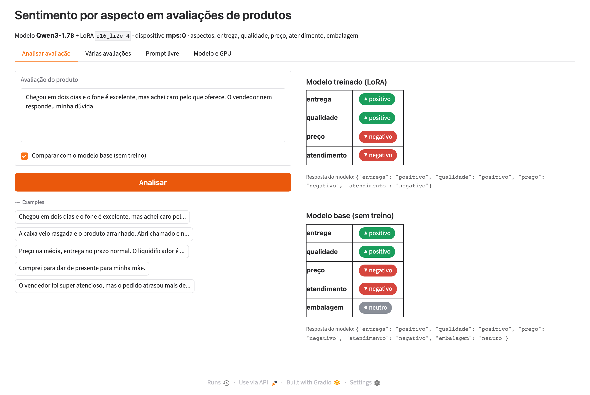
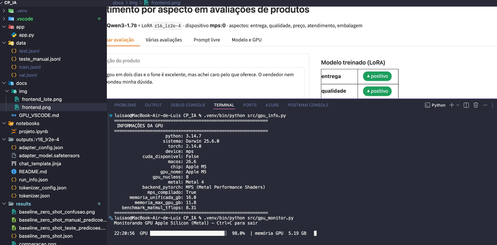

# Sentimento por aspecto em avaliações de produtos com Qwen3-1.7B + LoRA

Trabalho CP2/CP3 (4ESPY-2026): treinar uma LLM local em GPU para resolver um problema específico, testar diferentes
parâmetros, avaliar as respostas e disponibilizar um frontend para o usuário criar o prompt.

**Integrantes:** _Nome 1 (RM) · Nome 2 (RM) · Nome 3 (RM) · Nome 4 (RM) · Nome 5 (RM)_

---

## 1. Problema: sentimento por aspecto

Problema da lista sugerida pelo professor (categoria *Classificação*). Dada uma avaliação de produto, o modelo diz
o sentimento de **cada aspecto mencionado** e responde em JSON:

```
"Entrega rápida, mas o produto veio arranhado e achei caro."
→ {"entrega": "positivo", "qualidade": "negativo", "preço": "negativo"}
```

- **Aspectos:** entrega, qualidade, preço, atendimento, embalagem
- **Sentimentos:** positivo, negativo, neutro
- Aspectos não mencionados ficam fora do JSON. Sem nenhum aspecto, a resposta é `{}`.

Isso é mais útil que um sentimento geral: uma avaliação de 3 estrelas pode elogiar o produto e reclamar da
transportadora. Separar por aspecto mostra **onde** está o problema (logística, fornecedor, SAC...). A resposta tem
formato fixo e é **verificável automaticamente** campo a campo.

## 2. LLM escolhida: Qwen3-1.7B

| Critério | Motivo |
|---|---|
| Lista do professor | Qwen3 (0.6B, **1.7B**, 4B, 8B) |
| Português | Multilíngue, com bom desempenho em PT-BR |
| Tamanho | 1,7 bi de parâmetros: treina com LoRA na GPU de um notebook (Apple M5, 16 GB) |
| Formato | Segue instruções e gera JSON; o modo "raciocínio" (`<think>`) foi desligado para respostas diretas |
| Licença | Apache 2.0 |

**Técnica de treino: LoRA** (Low-Rank Adaptation). O modelo original fica congelado e treinamos pequenas matrizes de
baixo rank inseridas nas camadas lineares (de 0,3% a 4% dos parâmetros, conforme o rank). O adaptador final tem poucos MB.

## 3. Dados

Seguindo a sugestão do professor, os dados são **sintéticos e com verificação exata** (`src/data.py`):

- Banco de 184 frases escritas à mão (5 aspectos × 3 sentimentos), combinadas com conectivos de contraste
  ("mas", "porém", "por outro lado"...), frases sem aspecto ("Comprei para dar de presente.", "Recomendo!") e ruído
  de texto real (tudo minúsculo, sem acentos).
- Cada avaliação tem de 0 a 4 aspectos.

| Conjunto | Exemplos | Observação |
|---|---|---|
| Treino | 2000 | frases do "banco de treino" (75% das frases) |
| Validação | 200 | idem, usado para a loss de validação |
| **Teste** | 400 | **somente frases que nunca aparecem no treino** (25% restantes) |
| **Teste manual** | 40 | escritas à mão, linguagem natural, gírias e erros ("tá", "pq", "mt"), fora do gerador |

O teste manual mede se o modelo generaliza para avaliações reais, e não apenas para o padrão do gerador.

## 4. Como funciona

```
avaliação ──► prompt (system + chat template do Qwen3) ──► Qwen3-1.7B + LoRA ──► JSON {aspecto: sentimento}
```

- **Prompt:** o *system prompt* lista os aspectos, os sentimentos e o formato, com um exemplo
  (o mesmo prompt é usado no baseline, para a comparação ser justa).
- **Treino:** a loss é calculada **somente nos tokens da resposta** (o JSON). O prompt é mascarado.
- **Inferência:** geração determinística (greedy) em lotes. A resposta passa por um parser que valida o JSON e
  descarta aspectos ou sentimentos fora da lista.

## 5. Estrutura do repositório

```
├── src/
│   ├── config.py        # modelo, aspectos, prompt, detecção de GPU (CUDA > Metal/MPS > CPU)
│   ├── data.py          # gerador do dataset sintético
│   ├── modeling.py      # carregar modelo + LoRA, geração em lote, parser do JSON
│   ├── train.py         # fine-tuning com LoRA (parâmetros via linha de comando)
│   ├── evaluate.py      # métricas, matriz de confusão e respostas de cada exemplo
│   ├── experiments.py   # grade de experimentos (treino + avaliação)
│   ├── compare.py       # tabela e gráficos comparativos
│   ├── gpu_info.py      # informações da GPU + benchmark
│   └── gpu_monitor.py   # monitor de GPU ao vivo no terminal do VSCode
├── app/app.py           # frontend Gradio
├── notebooks/projeto.ipynb   # roteiro completo para rodar no VSCode
├── data/teste_manual.jsonl   # 40 avaliações escritas à mão
├── results/             # métricas (.json), respostas (.csv), gráficos (.png), log da execução
├── outputs/             # adaptador LoRA do melhor experimento
├── docs/GPU_VSCODE.md   # GPU (Metal/CUDA), VSCode e print
└── .vscode/tasks.json   # tarefas prontas: info da GPU, monitor, experimentos, frontend
```

## 6. Como executar

```bash
python3 -m venv .venv && source .venv/bin/activate
pip install -r requirements.txt     # NVIDIA: instale antes o torch com CUDA (docs/GPU_VSCODE.md)

python src/gpu_info.py              # confere a GPU
python src/data.py                  # gera os dados
python src/experiments.py           # baseline + 7 experimentos + comparação
python app/app.py --adapter outputs/<melhor_experimento>   # frontend em http://localhost:7860
```

Comandos individuais:

```bash
python src/train.py --run_name meu_teste --lora_r 32 --lr 1e-4 --epochs 2
python src/evaluate.py --name meu_teste --adapter outputs/meu_teste
python src/compare.py
```

## 7. Experimentos (parâmetros testados)

**Referência:** LoRA r=16, α=32, dropout 0,05, lr=2e-4, 1 época, LoRA em todas as camadas lineares,
batch efetivo 16 (4 × 4 de acumulação), scheduler cosseno com 5% de warmup, bf16, gradient checkpointing.
Cada experimento muda **um** parâmetro por vez, para isolar o efeito:

| Experimento | Parâmetro alterado | Hipótese |
|---|---|---|
| `baseline_zero_shot` | sem treino | ponto de partida |
| `r16_lr2e-4` | referência | — |
| `r4_lr2e-4` / `r64_lr2e-4` | rank do LoRA 4 / 64 | rank maior = mais capacidade e mais parâmetros treináveis |
| `r16_lr2e-5` / `r16_lr1e-3` | learning rate 10× menor / 5× maior | lr baixo aprende pouco; lr alto pode ficar instável |
| `r16_lr2e-4_ep2` | 2 épocas | mais épocas podem melhorar ou causar overfitting |
| `r16_lr2e-4_attn` | LoRA só na atenção (q, k, v, o) | menos parâmetros; mede a importância das camadas MLP |

## 8. Avaliação

| Métrica | O que mede |
|---|---|
| **JSON válido** | % de respostas no formato correto |
| **Acerto exato** | % de avaliações com **todos** os aspectos e sentimentos certos, sem aspectos a mais |
| **F1 dos pares** (principal) | F1 micro dos pares (aspecto, sentimento) |
| **F1 de detecção** | se o modelo encontra os aspectos mencionados, ignorando o sentimento |
| **Acurácia de polaridade** | entre os aspectos detectados, quantos sentimentos estão certos |
| F1 por aspecto, matriz de confusão | onde o modelo erra |

As respostas de cada modelo para cada exemplo ficam em `results/<experimento>_<conjunto>_predicoes.csv`
(texto, esperado, resposta crua do modelo, previsto, correto), para a análise qualitativa.

## 9. Resultados

<!-- RESULTADOS -->

## 10. Frontend

Interface em **Gradio** (`app/app.py`), com quatro abas:

1. **Analisar avaliação:** o usuário digita uma avaliação e vê os aspectos com sentimentos coloridos, lado a lado com a
   resposta do modelo **sem treino** (o LoRA é desligado na hora, sem carregar outro modelo).
2. **Várias avaliações:** uma por linha; mostra uma tabela e um resumo por aspecto.
3. **Prompt livre:** o usuário cria o próprio prompt (system + mensagem) e ajusta temperatura, top-p, tamanho
   máximo e o modo raciocínio do Qwen3, com resposta em streaming.
4. **Modelo e GPU:** informações da GPU e da configuração de treino.



## 11. GPU

Executado na **GPU do Apple M5 (Metal 4, 8 núcleos, 16 GB de memória unificada)** via PyTorch MPS. O código também roda
em NVIDIA/CUDA sem alterações. Veja em [docs/GPU_VSCODE.md](docs/GPU_VSCODE.md) a configuração, a comparação
Metal × CUDA e como gerar o print.



## 12. Limitações

- Dados sintéticos: as frases vêm de um banco finito. O teste com frases inéditas e o teste manual existem justamente
  para medir a generalização, mas avaliações reais são mais variadas.
- "Neutro" é a classe mais subjetiva ("preço razoável" é neutro ou positivo?).
- Aspectos fora da lista (cor, tamanho, garantia...) não são cobertos.

## Referências

- Qwen Team. *Qwen3 Technical Report*, 2025. <https://huggingface.co/Qwen/Qwen3-1.7B>
- Hu et al. *LoRA: Low-Rank Adaptation of Large Language Models*, 2021. <https://arxiv.org/abs/2106.09685>
- Pontiki et al. *SemEval-2014 Task 4: Aspect Based Sentiment Analysis*, 2014.
- Hugging Face Transformers e PEFT. <https://huggingface.co/docs>
- PyTorch MPS backend. <https://docs.pytorch.org/docs/stable/notes/mps.html>
