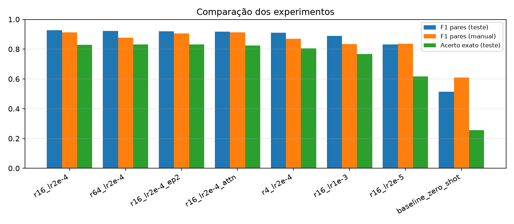
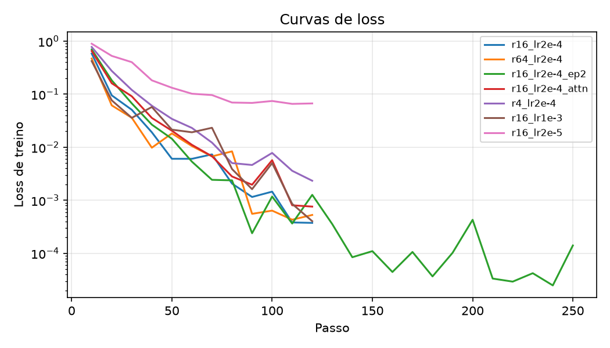

# Análise de sentimento em PT-BR com fine-tuning de LLM (Qwen2.5 + LoRA)

Trabalho da disciplina de IA: treinar uma LLM local em GPU para resolver um problema específico, testar
diferentes parâmetros, avaliar as respostas e disponibilizar um frontend para o usuário.

**Integrantes:** _Nome 1 (RM) · Nome 2 (RM) · Nome 3 (RM) · Nome 4 (RM) · Nome 5 (RM)_

---

## 1. Problema

Classificar o **sentimento de avaliações de produtos** escritas em português como **positivo**, **negativo** ou **neutro**.

É um problema real de e-commerce: com milhares de avaliações por dia, as lojas precisam identificar clientes insatisfeitos,
medir a satisfação por produto e priorizar o atendimento. A classificação tem resposta objetiva, o que permite medir o
modelo com métricas claras (acurácia, F1) e comparar configurações de treino de forma justa.

## 2. Modelo escolhido: Qwen2.5-1.5B-Instruct

| Critério | Motivo |
|---|---|
| Idioma | Multilíngue, com bom desempenho em português (modelos como TinyLlama são fracos em PT) |
| Tamanho | 1,5 bilhão de parâmetros: cabe e treina em uma GPU de 16 GB (T4) com LoRA |
| Licença | Apache 2.0, pode ser usado e distribuído livremente |
| Instruct | Já segue instruções, então funciona em zero-shot e serve de **baseline** |

**Técnica de treino: LoRA** (Low-Rank Adaptation). Em vez de atualizar os 1,5 bi de pesos, congelamos o modelo e treinamos
pequenas matrizes de baixo rank inseridas nas camadas lineares (de ~0,3% a ~5% dos parâmetros, conforme o rank). O treino fica
viável em GPU gratuita e o resultado é um adaptador de poucos MB.

## 3. Dados: B2W-Reviews01

- ~132 mil avaliações reais de clientes da Americanas/Submarino/Shoptime ([Hugging Face](https://huggingface.co/datasets/ruanchaves/b2w-reviews01), licença CC BY 4.0).
- Texto usado: `título + texto da avaliação` (20 a 800 caracteres, sem duplicatas).
- Rótulo derivado da nota: **1–2 estrelas → negativo · 3 → neutro · 4–5 → positivo**.
- O dataset original é desbalanceado (62% positivo, 26% negativo, 12% neutro). Por isso os splits são **balanceados**:

| Split | Por classe | Total |
|---|---|---|
| Treino | 1000 | 3000 |
| Validação | 100 | 300 |
| Teste | 200 | 600 |

## 4. Como funciona

```
avaliação ──► prompt (chat template do Qwen) ──► Qwen2.5-1.5B + LoRA ──► P(negativo), P(neutro), P(positivo)
```

- **Prompt:** um *system prompt* define a tarefa ("responda apenas positivo, negativo ou neutro") e a avaliação vai na mensagem do usuário.
- **Treino:** o modelo aprende a gerar o rótulo correto depois do prompt; a loss é calculada **somente nos tokens da resposta**.
- **Inferência:** em vez de gerar texto livre e tentar interpretar, calculamos a probabilidade que o modelo dá a cada um dos três
  rótulos como continuação do prompt. O modelo sempre responde um rótulo válido e ainda temos a **confiança** de cada classe.
  O mesmo método é usado no baseline zero-shot, então a comparação é justa.

## 5. Estrutura do repositório

```
├── src/
│   ├── config.py        # modelo, rótulos, prompt, detecção de GPU (CUDA > MPS > CPU)
│   ├── gpu_info.py      # informações da GPU + benchmark (usado no print)
│   ├── data.py          # download, limpeza e splits balanceados
│   ├── modeling.py      # carregar modelo/LoRA, classificação e geração
│   ├── train.py         # fine-tuning com LoRA (parâmetros via linha de comando)
│   ├── evaluate.py      # métricas, matriz de confusão e previsões no teste
│   ├── experiments.py   # grade de experimentos (treino + avaliação)
│   └── compare.py       # tabela e gráficos comparativos
├── app/app.py           # frontend Gradio
├── notebooks/treino_colab.ipynb   # roteiro completo para rodar no Colab (GPU T4)
├── docs/GPU_VSCODE.md   # CUDA, GPU no VSCode e print
├── docs/img/            # prints (GPU, frontend)
└── results/             # métricas, gráficos e previsões de cada experimento
```

## 6. Como executar

### No Google Colab (GPU T4, recomendado)

Abra `notebooks/treino_colab.ipynb` no Colab (ou no VSCode com a extensão Google Colab), escolha GPU T4,
troque `REPO_URL` pelo link deste repositório e execute as células em ordem.

### Localmente (PC com NVIDIA)

Instale o PyTorch com a versão CUDA correta ([docs/GPU_VSCODE.md](docs/GPU_VSCODE.md)) e depois:

```bash
pip install -r requirements.txt
python src/gpu_info.py                 # confere a GPU
python src/data.py                     # prepara os dados
python src/experiments.py              # baseline + todos os experimentos + comparação
python app/app.py --adapter outputs/r16_lr2e-4   # frontend em http://localhost:7860
```

Comandos individuais:

```bash
python src/train.py --run_name meu_teste --lora_r 32 --lr 1e-4 --epochs 2
python src/evaluate.py --name meu_teste --adapter outputs/meu_teste
python src/compare.py
```

O frontend também roda em Mac com Apple Silicon (MPS): basta copiar a pasta do adaptador treinado (`outputs/<experimento>`) do Google Drive.

## 7. Experimentos (parâmetros testados)

Referência: **LoRA r=16, α=32, lr=2e-4, 1 época, LoRA em todas as camadas lineares**, batch efetivo 16, scheduler cosseno.
Cada experimento muda **um** parâmetro por vez, para isolar o efeito:

| Experimento | Parâmetro alterado | Hipótese |
|---|---|---|
| `baseline_zero_shot` | sem treino | ponto de partida |
| `r16_lr2e-4` | referência | — |
| `r4_lr2e-4` / `r64_lr2e-4` | rank do LoRA 4 / 64 | rank maior = mais capacidade e mais parâmetros treináveis |
| `r16_lr2e-5` / `r16_lr1e-3` | learning rate 10× menor / 5× maior | lr baixo demais aprende pouco; alto demais fica instável |
| `r16_lr2e-4_ep3` | 3 épocas | mais épocas podem melhorar ou causar overfitting |
| `r16_lr2e-4_attn` | LoRA só na atenção (q,k,v,o) | menos parâmetros; mede a importância das camadas MLP |

## 8. Avaliação

Conjunto de teste com 600 avaliações balanceadas, nunca vistas no treino. Métricas:

- **Acurácia** e **F1 macro** (média do F1 das 3 classes; métrica principal, pois dá o mesmo peso a cada classe).
- **Acurácia polar**: só positivo × negativo (a classe neutra é ambígua por natureza).
- **Matriz de confusão**, **precisão/recall por classe** e **tempo de inferência** por exemplo.
- **Análise qualitativa:** o CSV `results/<experimento>_predicoes.csv` traz cada avaliação com o rótulo real, o previsto e a confiança,
  para inspecionar os erros.

## 9. Resultados

> _Preencher após rodar o notebook: copie aqui a tabela de `results/RESULTADOS.md`._

| Experimento | Acurácia | F1 macro | Acc pos/neg | Tempo de treino |
|---|---|---|---|---|
| baseline_zero_shot | | | | — |
| r16_lr2e-4 | | | | |
| ... | | | | |




**Conclusões:** _discutir qual configuração venceu, efeito do rank, do learning rate e das épocas, e o ganho sobre o baseline._

## 10. Frontend

Interface em **Gradio** (`app/app.py`) com três abas:

1. **Classificar avaliação:** o usuário digita uma avaliação e vê a probabilidade de cada sentimento, lado a lado com o modelo base sem LoRA.
2. **Prompt livre:** o usuário cria o próprio prompt (system prompt + mensagem) e ajusta temperatura, top-p e tamanho máximo da resposta, com respostas em streaming.
3. **Modelo e GPU:** informações da GPU e da configuração de treino do adaptador carregado.


## 11. GPU


Passo a passo de instalação do CUDA e de como gerar este print: [docs/GPU_VSCODE.md](docs/GPU_VSCODE.md).

## 12. Limitações

- A nota em estrelas é um rótulo "ruidoso": há avaliações 3 estrelas claramente positivas e notas 5 com reclamações.
- A classe **neutro** é a mais difícil: mistura elogios e críticas e também contém perguntas e comentários sem opinião.
- 3000 exemplos de treino foram escolhidos para caber no tempo da GPU gratuita; mais dados tendem a melhorar o resultado.

## Referências

- Qwen Team. *Qwen2.5 Technical Report*, 2024. <https://huggingface.co/Qwen/Qwen2.5-1.5B-Instruct>
- Hu et al. *LoRA: Low-Rank Adaptation of Large Language Models*, 2021. <https://arxiv.org/abs/2106.09685>
- Real et al. *B2W-Reviews01: An open product reviews corpus*, STIL 2019. <https://github.com/americanas-tech/b2w-reviews01>
- Hugging Face Transformers e PEFT. <https://huggingface.co/docs>
